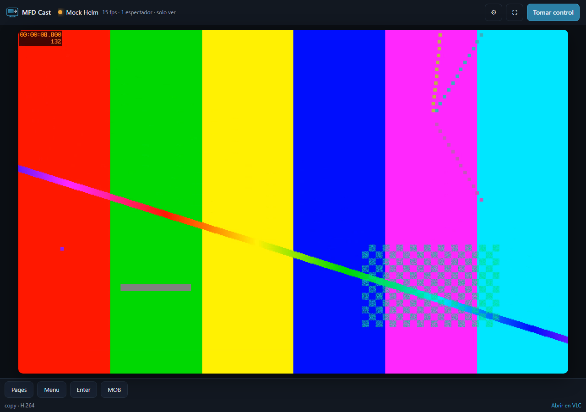

# signalk-mfd-cast

> **Build privado.** Uso local en tu barco. No está pensado para publicarse en
> npm ni en un repositorio público: `package.json` es `private` y tiene un
> `prepublishOnly` que aborta cualquier `npm publish`.

Plugin de Signal K que **retransmite la pantalla de un MFD Navico** (Simrad,
B&G, Lowrance) a un navegador web, con **control táctil y de teclas** opcional,
igual que hace la app GoFree Link.



```
┌──────────────┐   RTSP/TCP 554   ┌──────────────────────────────┐   WebRTC    ┌───────────┐
│  MFD Navico  │ ───────────────> │  go2rtc  (remux, -c copy)    │ ──────────> │ navegador │
│  screenmirror│                  │  gestionado por el plugin    │             │  <video>  │
│              │ <─────────────── │  control TCP 6633            │ <────────── │  táctil   │
└──────────────┘   Navico RP      └──────────────────────────────┘   WS/JSON   └───────────┘
```

## Por qué hace falta un puente

El MFD solo habla RTSP + un protocolo TCP propietario. Ningún navegador puede
abrir RTSP ni un socket TCP arbitrario, así que hace falta **alguien en medio**
que reempaquete el vídeo. Ese alguien es `go2rtc`, y el plugin lo arranca, lo
configura y lo para por ti.

Si solo quieres ver el plotter en un portátil sin navegador, VLC puede abrir el
RTSP directamente, sin pasar por el Pi:

```
rtsp://192.168.0.10:554/screenmirror
```

El visor incluye un enlace **«Abrir en VLC»** que descarga un `.m3u` con esa URL.

## Consumo de CPU

El objetivo del diseño es que **el Pi no decodifique ni codifique vídeo**. Se
reenvía el stream tal cual (`copy`), y el navegador lo decodifica por hardware.

| Situación | CPU en Pi 4 |
| --- | --- |
| Nadie mirando | ~0 % (go2rtc sin consumidores cierra la sesión RTSP) |
| H.264 en modo copia | 2–5 % de un núcleo |
| MPEG-2/4 con encoder hardware (`h264_v4l2m2m`) | 8–15 % |
| Recodificación por software (solo si la autorizas) | 25–40 % |
| MJPEG recodificado (lo que hace la app Android) | 60–120 % |

`transcodePolicy` vale `hardware-only` por defecto: si el stream no es H.264 y
no hay encoder hardware, **el plugin no emite vídeo** y te ofrece el enlace de
VLC en lugar de calentar el Pi en silencio. El modo real se muestra siempre en
la barra de estado y en `/status`.

## Requisitos

- Raspberry Pi 4 (ARM64) con Signal K en marcha.
- **Signal K reciente**, con `app.registerWebSocket()` (el vídeo funciona igual
  en versiones antiguas, pero el control táctil necesita ese soporte).
- Node.js 20 o superior.
- `ffmpeg` y `ffprobe` (`sudo apt install ffmpeg`).
- `go2rtc` (el script de instalación lo descarga; binario estático, ~15 MB).

## Instalación

```bash
sudo apt update && sudo apt install -y ffmpeg

# copia este directorio al árbol de plugins de Signal K
cd /ruta/a/signalk-mfd-cast
./scripts/install-local.sh --go2rtc
sudo systemctl restart signalk
```

El script copia a `${SIGNALK_NODE_CONFIG_DIR:-~/.signalk}/node_modules/signalk-mfd-cast`
y descarga `go2rtc` en
`~/.signalk/plugin-config-data/signalk-mfd-cast/bin/go2rtc`.

Si prefieres hacerlo a mano:

```bash
mkdir -p ~/.signalk/node_modules/signalk-mfd-cast
cp -r . ~/.signalk/node_modules/signalk-mfd-cast/
~/.signalk/node_modules/signalk-mfd-cast/scripts/install-go2rtc.sh
```

### Puesta en marcha

1. **Admin → Plugin Config → MFD Cast**.
2. Activa **Demo mode** y guarda. Abre `http://<ip-del-pi>:3000/signalk-mfd-cast/`:
   deberías ver un patrón de prueba. Esto valida go2rtc, ffmpeg, el WebSocket y
   el visor **sin necesidad de plotter**.
3. Desactiva Demo mode, pon la **IP del MFD** y guarda.
4. Abre el visor desde **Webapps → MFD Cast** o directamente por URL.

> El cambio de IP desde el propio visor (`POST /select`) es inmediato pero **no
> modifica la configuración guardada**: al reiniciar Signal K se vuelve a la IP
> del panel de administración. Sirve para probar varios MFD sin reiniciar.

## Configuración

| Opción | Defecto | Para qué sirve |
| --- | --- | --- |
| `mfdAddress` | — | IP del plotter |
| `rtspPort` | `554` | puerto RTSP |
| `rtspPath` | `/screenmirror` | ruta del stream |
| `controlEnabled` | `true` | habilita el protocolo remoto |
| `controlPort` | `6633` | TCP de control Navico |
| `clientMac` | vacío | MAC para `AUTHENTICATE`; vacío = la del interfaz que llega al MFD |
| `transcodePolicy` | `hardware-only` | `off`, `hardware-only`, `allow-software` |
| `maxWidth` | `1280` | solo si hay recodificación |
| `go2rtcPath` | vacío | ruta manual al binario |
| `go2rtcPort` | `1984` | API de go2rtc (solo loopback) |
| `webrtcPort` | `8555` | UDP/TCP del vídeo WebRTC |
| `manageGo2rtc` | `true` | si ya tienes go2rtc como servicio, desactívalo |
| `ffmpegPath` / `ffprobePath` | `ffmpeg` / `ffprobe` | binarios |
| `cpuNice` | `10` | prioridad `nice` de go2rtc en Linux |
| `extraSourceOptions` | vacío | fragmento extra de go2rtc, p. ej. `#timeout=10` |
| `demoMode` | `false` | patrón de prueba sin MFD |

## Uso

- **Ver**: la pantalla aparece sola al abrir el visor.
- **Control**: pulsa **«Tomar control»**. El control es **exclusivo**: si otro
  navegador lo tiene, verás «Control en uso». Se libera al cerrar la pestaña o
  al pulsar «Soltar control».
- **Toques**: arrastra o toca sobre el vídeo; se envían como press/move/release
  escalados a la resolución real del MFD (la que anuncia el `PONG`).
- **Teclas**: la barra inferior se construye con las teclas que anuncia el
  propio MFD (Pages, Menu, Zoom ±, Enter, Cancel, MOB, Go To, Mark…).
- **Pantalla bloqueada**: si el MFD envía `LOCK`, aparece un aviso y solo se
  permiten las teclas de su lista permitida.
- **Indicadores**: fps, latencia del WebSocket y número de espectadores.

El modo inicial es siempre **solo ver**; los toques no llegan al plotter hasta
que tomas el control.

## Cómo decide el pipeline

Al arrancar se ejecuta **un** `ffprobe` (≈1 s) y se elige:

| Códec | Modo | Resultado |
| --- | --- | --- |
| H.264 | `copy` | go2rtc reenvía el RTP; el navegador decodifica |
| MPEG-2 / MPEG-4 y `h264_v4l2m2m` disponible | `transcode-hardware` | recodifica con el encoder del Pi |
| MPEG-2 / MPEG-4 sin hardware | `unsupported` | no emite; enlace a VLC |
| Códec desconocido | `copy` (a ciegas) | intenta copiar; si el navegador no lo acepta, `/diagnostics` lo explica |

La decisión, el códec y el motivo están en `/plugins/signalk-mfd-cast/diagnostics`.

## Diagnóstico

```bash
./scripts/diagnose.sh 192.168.0.10
```

Imprime arquitectura, versión de ffmpeg, disponibilidad de `/dev/video11`, si
`go2rtc` está instalado, el resultado de `ffprobe` y una medida del coste de
decodificar 5 s del stream. La salida no contiene credenciales y se puede pegar
tal cual.

Desde el navegador:

| Ruta | Contenido |
| --- | --- |
| `/plugins/signalk-mfd-cast/status` | estado, pipeline, control, espectadores |
| `/plugins/signalk-mfd-cast/stats` | CPU y RSS de go2rtc, temperatura del Pi |
| `/plugins/signalk-mfd-cast/diagnostics` | probe, hardware, log de go2rtc |
| `/plugins/signalk-mfd-cast/playlist.m3u` | lista para VLC |

## Probar sin hardware

```bash
# Terminal 1: MFD simulado (responde PONG, SESSION y registra toques)
node scripts/mock-mfd.js --port 6633

# Terminal 2: plugin en modo demo
#   Admin → MFD Cast → Demo mode + IP 127.0.0.1 + controlPort 6633
```

El simulador imprime cada `TOUCH` y `KEY` que recibe, así se comprueba el
escalado de coordenadas y el mapeo de teclas sin plotter.

## Problemas frecuentes

| Síntoma | Causa probable | Solución |
| --- | --- | --- |
| «No se encontró go2rtc» | binario ausente | `./scripts/install-go2rtc.sh` o `go2rtcPath` |
| «go2rtc no arrancó» | puerto 1984/8555 ocupado | `/diagnostics` → log; cambia `go2rtcPort`/`webrtcPort` |
| No se ve vídeo pero el estado es `ready` | el MFD no entrega H.264 o el AP bloquea UDP | mira `/diagnostics`; prueba `http://<pi>:3000/plugins/signalk-mfd-cast/playlist.m3u` en VLC |
| «Stream no compatible» | MPEG-2/4 sin encoder hardware | instala ffmpeg con `h264_v4l2m2m` o usa VLC |
| Control en «solo ver» | el MFD exige autenticación y falta MAC | pon `clientMac` o conéctate desde la misma interfaz que ve el MFD |
| El visor pide login / 401 | Signal K tiene seguridad activada | inicia sesión como usuario con permiso de lectura |
| Latencia alta | red Wi-Fi cargada | acerca el Pi al AP; el modo copia no reduce el bitrate original |

## Seguridad

- `go2rtc` escucha su API y su servidor RTSP **solo en 127.0.0.1**.
- El navegador nunca habla con `go2rtc`: el intercambio SDP se proxya por el
  plugin.
- El puerto **8555/UDP-TCP** sí queda expuesto a la LAN, porque por ahí viaja el
  vídeo cifrado de WebRTC.
- Las rutas de estado y el WebSocket no añaden autenticación propia: cualquiera
  en la red del barco puede ver la pantalla. El **control** es exclusivo, pero
  no está autenticado más allá del acceso a Signal K.
- Si activas la seguridad de Signal K, las rutas `readonly` piden sesión; VLC no
  puede autenticarse, así que usa la URL RTSP directamente en ese caso.

## Límites conocidos

- **Un MFD** por instancia (se puede cambiar de IP en caliente desde el visor).
- El códec real del MFD es desconocido hasta el primer `diagnose.sh`; el plugin
  se adapta, pero no puede adivinar.
- El modo copia **no reduce el bitrate**; si el Wi-Fi va justo, solo recodificar
  lo bajaría.
- Sin audio (el screen mirror no lo lleva).
- Sin descubrimiento multicast todavía: la IP se escribe a mano o se cambia
  desde el visor.
- Sin fallback MSE/MJPEG: si el AP bloquea UDP, WebRTC no conecta. Es la
  siguiente entrega, solo si hace falta.

## Desarrollo

```bash
npm test                 # 78 pruebas, sin red ni hardware
node scripts/mock-mfd.js # MFD simulado para el canal de control
```

```
plugin/
  index.js      plugin Signal K: schema, rutas, WebSocket, ciclo de vida
  config.js     normalización de opciones
  probe.js      ffprobe + detección de h264_v4l2m2m
  pipelines.js  decisión copy / hardware / software / unsupported
  go2rtc.js     proceso, YAML, API y proxy WebRTC
  remote.js     protocolo Navico TCP 6633
  stats.js      CPU/RSS/temperatura
public/
  index.html · player.js · control.js · style.css
scripts/
  install-local.sh · install-go2rtc.sh · diagnose.sh · mock-mfd.js
```

## Licencia

No contiene código de Navico. El material gráfico es propio.
